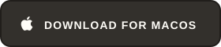
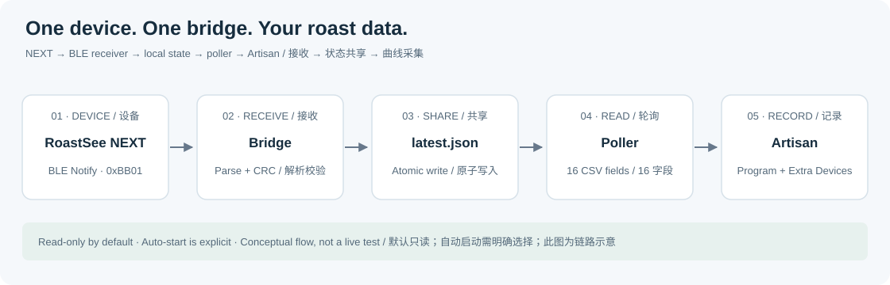
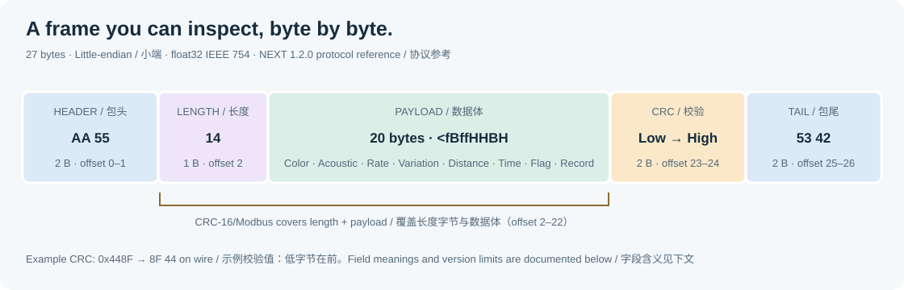

<a href="https://lebrewtech.com/">
  <picture>
    <source media="(prefers-color-scheme: dark)" srcset="assets/brand/lebrew-wordmark-dark.png">
    
  </picture>
</a>

RoastSee NEXT → Artisan
======================

A standalone BLE bridge for coffee-roasting data.

[](README.md)
[](README.zh-CN.md)

<p align="center">
  <a href="https://github.com/lebrew-tech/RoastSee-NEXT-Artisan-Bridge/releases/latest/download/RoastSeeNEXT-Artisan-Windows-x64.zip">
    
  </a>
  <a href="https://github.com/lebrew-tech/RoastSee-NEXT-Artisan-Bridge/releases/latest/download/RoastSeeNEXT-Artisan-macOS-universal2.zip">
    
  </a><br>
  Windows x64 · One Mac download for Intel and Apple Silicon · No Python installation needed
</p>


[](https://github.com/lebrew-tech/RoastSee-NEXT-Artisan-Bridge/releases/latest)
[](LICENSE)

[Download](https://github.com/lebrew-tech/RoastSee-NEXT-Artisan-Bridge/releases/latest) · [Artisan settings](#artisan-settings) · [Quick start](#quick-start) · [Firmware compatibility](#next-firmware-compatibility) · [Packet reference](#packet-reference) · [Known limits](#diagnostics-and-known-limits)

<a id="artisan-settings"></a>

## ⚙️ Start here: Artisan settings

**Use the same Artisan settings on Windows and Mac. Add two extra-device groups: `Program 34` and `Program 56`, giving four readings in total. Add `Program 78` if you also need distance.** Each Program group contains two channels; the setup is not limited to two readings.

1. **Save your configuration:** choose **Help → Save Settings** in Artisan. This setup changes the main input to **Prog**; an existing roaster temperature connection needs separate configuration.
2. **Enable expert mode:** open **Config → Mode → Expert**, then **Config → Device** and select **Prog** as the input.
3. **Select the poller:** use the upper **Select** button in **External Program** and choose the file below from the extracted folder. **Leave the lower Output checkbox unchecked.** Do not select the receiver or a startup script.

| System | File to select as External Program |
| --- | --- |
| Windows | `artisan_next_poll.exe` |
| Mac (Intel / Apple Silicon) | `artisan_next_poll` (no suffix; not the `.app`) |

4. **Add channels:** add the groups below in **Extra Devices**. Enable **LCD** for numeric readings and **Curve** for plots on each channel you want to see. The dropdown displays names such as `Program 34`, without a leading `+`.

| Extra-device group | First channel | Second channel | Recommendation |
| --- | --- | --- | --- |
| `Program 34` | Agtron | Acoustic activity (`voice`) | Add |
| `Program 56` | Agtron rate | Agtron variability | Add |
| `Program 78` | Distance | Bridge-latched time, not a validated yellow time | Add for distance |
| `Program 910` | Bridge-generated flag, not validated for automatic DRY | Unused | Leave out for now |

5. **Monitor and record:** keep the bridge window open, start live measurement on NEXT, and wait for `received live sample`. In Artisan, click **ON** to monitor, then **START** to record. Press **Ctrl+C** to exit the bridge; stop measurement on the NEXT itself.

**What should you see?** Check the extra channels for Agtron and acoustic readings. Binary live frames contain no temperature, so **ET / BT values of `-1` are expected**. The stock Program interface reads only the first **10 columns** and has no `Program 1112 / 1314 / 1516` devices. This setup cannot directly display the FC/SC extension fields or provide reliable automatic yellow tagging. See the [official External Programs help](https://github.com/artisan-roaster-scope/artisan/blob/master/src/help/programs_help.py).

<a id="quick-start"></a>

## 🚀 Start in four steps

**Windows x64 · Target NEXT firmware: 1.2.0.** Older versions are not declared supported; hardware verification and yellow-event limits are explained [here](#next-firmware-compatibility).

1. **Download and extract** the [Windows ZIP](https://github.com/lebrew-tech/RoastSee-NEXT-Artisan-Bridge/releases/latest). Keep the entire folder together; no Python installation is needed.
2. **Start the bridge.** Enable Bluetooth, close phone apps connected to NEXT, and run `START_HERE.cmd`. On NEXT, enter live roasting and start measurement. Keep the bridge window open; wait for `received live sample`.
3. **Set up Artisan.** Save your current configuration with **Help → Save Settings**. Open **Config → Mode → Expert**, then **Config → Device** and select **Prog** as the input. In **External Program**, use the upper **Select** button to choose `artisan_next_poll.exe`. Leave **Output** unchecked. This changes the main-device selection.
4. **Show the curves.** Follow the [Artisan settings above](#artisan-settings): add **`Program 34` and `Program 56`** and enable **LCD / Curve** for the channels you want. Click **ON** to monitor; click **START** when you want to record.

**Stop:** press **Ctrl+C** in the bridge window. For the remaining channels or automatic measurement startup, see [Detailed setup](#setup-details).

### 🍎 Mac: four steps

1. **Download one Mac ZIP** from [Releases](https://github.com/lebrew-tech/RoastSee-NEXT-Artisan-Bridge/releases/latest): **`RoastSeeNEXT-Artisan-macOS-universal2.zip`** runs on both Apple Silicon (M-series) and Intel. Extract the entire folder; do not move the `.app` out of it. No Python installation or chip selection is needed.
2. **Start receiving.** Open `START_HERE.command`; allow Bluetooth access, then start live measurement on NEXT. Keep the Terminal window open. `START_LIVE.command` is the explicit automatic-measurement option.
3. **Configure Artisan** as in Windows step 3, but select the extracted folder's **`artisan_next_poll`** file as External Program (no `.exe` suffix and not the `.app`). Save your current Artisan configuration first.
4. Follow the [Artisan settings above](#artisan-settings): add **`Program 34` and `Program 56`**, enable **LCD / Curve**, and click **ON** to monitor or **START** to record. Stop the bridge with **Ctrl+C**.

<a id="mac-first-launch"></a>

#### 🔐 First launch: macOS security warning

These builds are ad-hoc signed and have **not been notarized by Apple**. If macOS reports an unidentified developer or says Apple cannot check the file for malicious software, first confirm that your unchanged copy came from this repository, then:

1. Try opening `START_HERE.command`, then dismiss the warning.
2. Open **System Settings → Privacy & Security**.
3. Scroll down to **Security**, find the blocked file and click **Open Anyway**. Confirm **Open** when asked.
4. Open `START_HERE.command` again. If a separate warning names `RoastSeeNEXTBridge`, review that file separately using the same steps.
5. When the bridge requests Bluetooth access, allow it. You can review the permission under **Privacy & Security → Bluetooth**.

**If there is no Open Anyway button, or the warning says the software will damage your computer or that malware was detected, stop and share the exact message or a screenshot in [Issues](https://github.com/lebrew-tech/RoastSee-NEXT-Artisan-Bridge/issues).** Do not disable macOS security protections to work around that warning. See [Apple's official instructions](https://support.apple.com/102445).

macOS 15 is the native build/smoke-check environment; older macOS versions and actual BLE reception have not been validated. These checks do not reproduce first-launch security prompts on a user's Mac.

Mac state is shared at `~/Library/Application Support/RoastSeeNEXT/latest.json`, independent of the working directory. Optional diagnostic command: `./START_HERE.command --log-level DEBUG`. For an offline check, supply a separate `--state` file with `--mock-live`, then use `./artisan_next_poll --state` with the same file.

## ☕ Summary

This tool connects LeBrew RoastSee NEXT to **[Artisan](https://artisan-scope.org/)**, an open-source application for recording and examining coffee roast profiles. The bridge receives NEXT readings over Bluetooth LE and presents them through Artisan's external **Program** interface. Install Artisan separately; its [source code](https://github.com/artisan-roaster-scope/artisan), [downloads](https://artisan-scope.org/download/), and [documentation](https://artisan-scope.org/docs/) are maintained by the Artisan team.

**Target NEXT version: firmware 1.2.0.** Supported scope is the documented 27-byte BLE live-frame format and Artisan Program data export, checked against source and offline tests. No NEXT firmware version has end-to-end hardware certification in this release. Accurate automatic yellow/DRY tagging is outside the supported scope because the yellow-channel mismatch remains unresolved. **Older firmware and unknown versions are not declared supported.**

## 🌐 Related tools

| Tool | GitHub / download | What it is for |
| --- | --- | --- |
| NEXT web console | [RoastSee NEXT Console](https://github.com/lebrew-tech/RoastSee-NEXT-Console) | A separate browser-based NEXT interface; firmware command compatibility must be checked independently. |
| One-click firmware updater | [LEBREW Firmware Updater](https://github.com/lebrew-tech/LEBREW-Firmware-Updater) · [Downloads](https://github.com/lebrew-tech/LEBREW-Firmware-Updater/releases/latest) | A separate guided utility for product selection, firmware download and flashing. |
| Artisan | [Artisan source](https://github.com/artisan-roaster-scope/artisan) · [Downloads](https://artisan-scope.org/download/) | The roast-recording application receiving this bridge's Program output. |

The bridge package does not include these applications or any firmware. For the updater, select the correct NEXT model and confirm the actual firmware version offered by its published catalog; do not assume its default latest version is 1.2.0. After an update, confirm the device's Kernel Version again.

<a id="next-firmware-compatibility"></a>

## 🔎 NEXT firmware compatibility

NEXT firmware versions, hardware revisions, and this bridge's `v0.1.x` release numbers are separate. Check the NEXT's **About / Info** page and read **Kernel Version (内核版本)** before selecting a setup. The bridge does not query firmware versions automatically and does not include a firmware image or updater.

| NEXT firmware | Status for this open-source bridge |
| --- | --- |
| **1.2.0** | Reference version for the binary layout and parameter meanings documented here. Source inspection and offline checks only; yellow slots 8/9 are not validated true event markers. |
| **1.1.5–1.1.8** | Historical integration versions; not an independently verified compatibility range for this release. The unified `NEXT:` commands were introduced in 1.1.5. The 1.1.8 build discussed during integration was an internal test build, not a firmware download supplied here. |
| **1.1.4 and earlier** | Legacy devices. The older command set does not support the newer `NEXT:` commands. The bridge uses the legacy `roasting` / `start` startup aliases, but that alone does not establish full compatibility or identical field meanings. |
| Other / unknown | Not assessed; check firmware, incoming packet layout, and field semantics before relying on the data. |

The binary parser recognizes `AA 55 14 ... CRC ... 53 42`; recognizing that envelope is not a guarantee that every firmware assigns the same meaning to each payload field. In particular, the inspected **1.2.0 `time_yellow` and variability semantics differ from legacy descriptions**. Use the packet notes and known limits below. The documented Artisan setup requires Program / +Program channels; a minimum end-to-end-tested Artisan version has not been established for this bridge release.

## 💡 Why this project exists

This bridge began as a practical integration tool during LeBrew's work with the Artisan team in September 2026. The immediate goal was to make the NEXT enter live measurement, receive its BLE readings, and expose them through Artisan's existing **Program** channels, without changing or rebuilding Artisan.

Subsequent integration discussions with Marko Luther clarified two distinct issues: starting a BLE connection does not always start measurement, and NEXT color/acoustic/distance data belong in **Extra Devices**, while Artisan's ET/BT channels are for roasting-machine temperatures. Firmware versions also accept different command sets. This motivated an explicit startup mode, visible connection logs, and a documented field mapping.

In October, Marko described the early [NEXT web console](https://github.com/lebrew-tech/RoastSee-NEXT-Console) as **“AI slub”** (his wording), sharply questioning its readiness and real-device usability. His NEXT connected over BLE, but the console's page-control commands did not work on his unit. Our follow-up identified a firmware command-set mismatch: the console expected newer `NEXT:` commands, while his unit accepted the legacy aliases. This exposed a need for clearer version requirements and device-based validation, which this documentation makes explicit. That report concerned the early web console, rather than an evaluation of this packaged bridge release.

> We took the reproducible compatibility issue seriously. Adjectives, however, are not part of the firmware command set. This release therefore makes the version assumptions, packet formats, and unverified limits explicit; the behavior is there to inspect, not to infer from a label.

Artisan also offers native NEXT support. This project remains a standalone compatibility, debugging, and protocol-reference tool. Native integration may be the simpler option for a supported device/software combination; see [Artisan's LeBrew device page](https://artisan-scope.org/devices/lebrew/). This repository is maintained by LeBrew and is separate from the Artisan project.

## 🔗 At a glance

| Capability | Behavior |
| --- | --- |
| Receive | BLE notifications from `RoastSeeNEXT`, characteristic `0xBB01` |
| Validate | Binary length, tail, CRC; ASCII syntax and numeric representation |
| Share | Atomically replace a local JSON state file |
| Integrate | Print one line of 16 comma-separated fields for Artisan Program |
| Start | Read-only by default; optional `roasting` then `start` commands |
| Run | Windows x64 or one macOS Universal 2 package for both chip families; Python source is also available |



> **Firmware semantics matter.** The parser accepts the 27-byte binary frame used by the inspected 1.2.0 firmware, plus two ASCII formats. Some legacy field names do not describe their current firmware meaning. In particular, read the yellow-time and variability notes below before using those channels.

<a id="setup-details"></a>

## 🧭 Detailed setup

### 1 · Extract and connect

Download the Windows ZIP from [Releases](https://github.com/lebrew-tech/RoastSee-NEXT-Artisan-Bridge/releases), then **extract the entire folder**. Keep `_internal` beside both executables. No separate Python or pip installation is needed for this bundle. Use Windows 10/11 x64 with Bluetooth LE support; this build was checked on Windows 11.

| File | Purpose |
| --- | --- |
| `START_HERE.cmd` | Receive only; start measurement manually on the NEXT |
| `START_LIVE.cmd` | Enter the live screen and start measurement automatically |
| `RoastSeeNEXTBridge.exe` | Long-running receiver; keep it open |
| `artisan_next_poll.exe` | Short-lived program Artisan calls for each sample |
| `_internal/` | Bundled Python runtime and Bluetooth dependencies |

1. Turn on Windows Bluetooth. Close phone apps, nRF Connect, and other clients holding the NEXT connection.
2. Run `START_HERE.cmd` or explicitly choose `START_LIVE.cmd`.
3. Power on the NEXT. In read-only mode, manually enter its live roasting screen and start measurement.
4. Wait for `subscribed to ...bb01...` and `received live sample`.
5. Configure Artisan as below, then click **ON**. Stop the receiver with **Ctrl+C**.

`START_LIVE.cmd` writes `roasting\r\n`, waits 1.5 seconds for the page change, then writes `start\r\n`. It starts live measurement on the device. Closing the bridge does not send a stop command; stop measurement on the device when needed.

### 2 · Configure Artisan

Save your current Artisan configuration using **Help → Save Settings** first. This standalone setup selects **Prog** as the input, replacing the current main-device selection. It does not combine the bridge with an existing roaster temperature connection.

Open **Config → Mode → Expert**, then **Config → Device**. Select the **Prog** radio button. In **External Program**, use the upper **Select** button to choose `artisan_next_poll.exe` on Windows, or the extracted folder's `artisan_next_poll` on Mac. Leave the separate **Output** checkbox unchecked. For example, a Windows path is:

```text
"C:\Tools\RoastSeeNEXT-Artisan-Windows-x64\artisan_next_poll.exe"
```

Add the following **Extra Devices** and enable each desired **LCD** and/or **Curve**:

| Device | Channel 1 | Channel 2 |
| --- | --- | --- |
| `Program 34` | Agtron | Acoustic activity (`voice`) |
| `Program 56` | Agtron rate | Agtron variability (legacy filtered field) |
| `Program 78` | Distance | Bridge-latched time (not a validated yellow time) |
| `Program 910` | Bridge-generated flag (not validated for DRY) | Unused |

Add **Program 34 + Program 56**, and optionally **Program 78** for distance; the full walkthrough is in [Artisan settings above](#artisan-settings). Artisan removes the leading `+` from extra-device names in the dropdown. The current official Program interface reads only the first **10 values**, and does not provide Program 1112 / 1314 / 1516 devices. The bridge's FC/SC values in raw columns 11–16 therefore do not appear through this setup. See the [official External Programs help](https://github.com/artisan-roaster-scope/artisan/blob/master/src/help/programs_help.py).

The NEXT live binary frame has no temperature. **ET and BT are `-1`**. A zero or missing temperature curve does not establish whether the NEXT data arrived; inspect its Extra Device channels and bridge logs. The 8-field ASCII extension can supply ET.

<a id="packet-reference"></a>

## 📡 Packet reference

### BLE transport

| Item | Value |
| --- | --- |
| Advertised local name | `RoastSeeNEXT` (receiver also accepts names containing it) |
| Service | `000000bb-0000-1000-8000-00805f9b34fb` |
| Read / Write / Notify characteristic | `0000bb01-0000-1000-8000-00805f9b34fb` |
| Notify descriptor | CCCD `0x2902`; enable notifications before waiting for data |
| Optional startup writes | ASCII `roasting\r\n`, then `start\r\n` |

The receiver scans and establishes GATT itself; pairing in Windows Settings is not required. Notifications may split one frame or carry multiple frames, so the live parser buffers data across notifications. This bridge handles live frames and complete event summaries; it does not download history or parse all firmware command/event messages.

### Binary live frame · 27 bytes

All offsets below start at zero. Multibyte payload values and the CRC are **little-endian**. Floats are IEEE 754 binary32. The packed payload is equivalent to Python `struct` format **`<fBffHHBH`**, with no padding.



```text
AA 55 │ 14 │ 20-byte payload │ CRC low CRC high │ 53 42
 2 B    1 B        20 B              2 B           2 B
```

| Frame offset | Bytes | Type | Field / meaning in inspected 1.2.0 firmware |
| --- | ---: | --- | --- |
| 0–1 | 2 | Fixed | Header `AA 55` |
| 2 | 1 | `uint8` | Payload length `0x14` = 20; excludes envelope and CRC |
| 3–6 | 4 | `float32` | `curve_agtron`: live color value, Agtron scale |
| 7 | 1 | `uint8` | `voice`: acoustic event activity; see notes below |
| 8–11 | 4 | `float32` | `agtron_rate`: magnitude of color change, Agtron units/min |
| 12–15 | 4 | `float32` | `weighted_median_mean_agtron`: variability, despite the legacy name |
| 16–17 | 2 | `uint16` | `distance`: laser distance, mm |
| 18–19 | 2 | `uint16` | `time_yellow`: transmitted roast elapsed time in seconds; see mismatch below |
| 20 | 1 | `uint8` | `flag_yellow`: firmware yellow indication; bridge rewrites this field |
| 21–22 | 2 | `uint16` | `cnt_record`: roast record number; bridge output slot is unused |
| 23–24 | 2 | `uint16` | CRC-16/Modbus, low byte first |
| 25–26 | 2 | Fixed | Tail `53 42` |

**Parameter interpretation.** These meanings were checked against the 1.2.0 source; older firmware can differ.

- `voice` is a per-sample acoustic activity signal derived from a rolling one-second event density, gated around yellow detection and scaled for transmission. It is not calibrated dB, a cumulative crack count, or a reliable standalone first-crack trigger. The bridge forwards received values without extra smoothing.
- `agtron_rate` is calculated as `abs(color_3_seconds_ago - current_color) * 20`. The magnitude loses the direction of color change.
- `weighted_median_mean_agtron` is currently calculated as `4 * IQR / 3` over a 20-point window. It describes color variability, not a smoothed absolute Agtron value and not another rate. Historical labels such as “Filtered Agtron” or “FoR” can be misleading.
- `cnt_record` increments when a roast starts; it is not a per-frame sample sequence. The bridge deliberately outputs `-1` in Artisan slot 10.
- **Yellow mismatch:** the inspected firmware sends elapsed roast seconds as `time_yellow`. The existing bridge instead latches the first nonzero value and emits a single flag, resetting when the incoming value returns to zero. It also replaces the incoming `flag_yellow`. Therefore slots 8/9 are not reliable true yellow-event markers with this firmware. Do not configure automatic DRY tagging from them without resolving and validating that difference.

### CRC and a complete example

Use CRC-16/Modbus: initial value `0xFFFF`, reflected polynomial `0xA001`, no final XOR. Cover **offsets 2 through 22 inclusive**: the length byte plus the 20-byte payload. Exclude header, CRC bytes, and tail.

This synthetic frame represents color `84.6`, voice `3`, rate `1.2`, variability `84.9`, distance `327`, time `95`, flag `1`, record `12`. Values demonstrate decoding and are not a measured roast:

```text
AA 55 14 33 33 A9 42 03 9A 99 99 3F CD CC A9 42
47 01 5F 00 01 0C 00 8F 44 53 42
```

The CRC is **`0x448F`**, transmitted as **`8F 44`**. Float32 values may decode slightly above/below their decimal examples. The parser requires a matching length, tail and CRC before accepting a binary frame. It does not additionally validate physical sensor ranges or reject nonfinite binary floats.

### Compatible ASCII live formats

The receiver also accepts comma-separated ASCII terminated by `\r\n` or NUL (`00`). These formats have no CRC. Seven fields:

```text
CurveAgtron,Voice,AgtronRate,LegacyFilteredField,Distance,TimeYellow,FlagYellow
84.6,3,1.2,84.9,327,95,1\r\n\0
```

The eight-field extension prepends ET:

```text
ET,CurveAgtron,Voice,AgtronRate,LegacyFilteredField,Distance,TimeYellow,FlagYellow
45.5,84.6,3,1.2,84.9,327,95,1\r\n\0
```

The parser checks field count, finite numbers and integer-valued voice/distance/time/flag fields. It does not enforce physical ranges or a Boolean-only flag. Seven-field data get ET `-1`; both ASCII formats set the unused record value to `-1`. The ASCII examples are compatibility/test data, not a claim that 1.2.0 sends text live frames. The firmware's UART text with a trailing record number is a different eight-field layout and must not be fed into this ET-first format.

### Roast-end event summary · ASCII

The summary is a separate message, not a live sample. The parser expects text starting with `Y_time:` and all 12 named values. For example:

```text
Y_time:95,Y_agtron:84.6,Y_ROR:1.2,FC_time:180,FC_agtron:72.0,FC_ROR:2.3,SC_time:240,SC_agtron:60.5,SC_ROR:1.1,D_time:300,D_agtron:55.0,D_ROR:0.8
```

| Prefix / suffix | Meaning |
| --- | --- |
| `Y_` | Yellow event |
| `FC_` | First crack event |
| `SC_` | Second crack event |
| `D_` | Drop / roast-end event |
| `time` | Event time from roast start, seconds |
| `agtron` | Color value at the event |
| `ROR` | Color change rate at the event, firmware-supplied |

Separators/whitespace can vary because values are matched by key. The parser ignores bytes after the first NUL or `A5` padding byte. It requires the **entire summary in one notification**; split summaries are not reassembled. All four events enter JSON; FC/SC values also occupy raw poller columns 11–16, which the current official Artisan Program interface does not consume. Summary `Y_time` is stored as `yellow_time`, distinct from live `time_yellow`, so it does not correct columns 8/9. Reported event values are not a guarantee of automatic event detection.

## 📊 Raw poller output · 16 fields

The poller writes exactly one CSV line with a trailing newline; diagnostic logging belongs to the receiver. **Current official Artisan reads columns 1–10; columns 11–16 are raw extensions, not configurable stock Program channels.** Slots are one-based:

| Slot | Meaning | Format / fallback |
| ---: | --- | --- |
| 1 | ET, only available in eight-field ASCII | 3 decimals; otherwise `-1.000` |
| 2 | BT | Always `-1` |
| 3 | Live Agtron | 3 decimals |
| 4 | Raw received acoustic activity | Integer |
| 5 | Agtron rate | 3 decimals |
| 6 | Legacy filtered / current variability field | 3 decimals |
| 7 | Distance, mm | Integer |
| 8 | Bridge-latched yellow-time field | Integer; see yellow mismatch |
| 9 | Bridge-generated one-sample yellow flag | Integer; see yellow mismatch |
| 10 | Unused record slot | Always `-1` |
| 11 | FC time, seconds | Integer |
| 12 | FC Agtron | 3 decimals |
| 13 | FC ROR | 3 decimals |
| 14 | SC time, seconds | Integer |
| 15 | SC Agtron | 3 decimals |
| 16 | SC ROR | 3 decimals |

Example before receiving an event summary:

```text
-1.000,-1,84.600,3,1.200,84.900,327,95,1,-1,-1,-1.000,-1.000,-1,-1.000,-1.000
```

Missing, unreadable, or invalid-JSON state yields sixteen `-1` placeholders. The state is stored at `%LOCALAPPDATA%\RoastSeeNEXT\latest.json` on Windows. Both programs accept `--state PATH`; use the same path for both. This file contains the latest reading, not a time series.

<a id="diagnostics-and-known-limits"></a>

## 🛠️ Diagnostics and known limits

| Symptom | Check |
| --- | --- |
| Device not found | Bluetooth enabled, NEXT powered on, other BLE clients disconnected |
| Subscribed but no readings | Device in live screen and measuring; try explicit `START_LIVE.cmd` |
| Data in logs but no curves | Program path, Extra Devices, LCD/Curve flags; inspect extra channels |
| Only `-1` values | Receiver has not written valid state, or poller uses another state path |
| Lost connection but values remain | State has no freshness timeout; last values remain available |

Run `RoastSeeNEXTBridge.exe --log-level DEBUG` to inspect actual notification hex. Avoid guessing the protocol from a connection-success message alone.

This is a packaging release of the existing bridge behavior. In addition to the yellow mismatch and split-summary limit described above:

- Offline checks cover parsing, storage, poller output and frozen Windows backend imports. Actual BLE reception and an Artisan roasting session have **not** been verified for this release.
- A new live sample replaces the state, so a summary's FC/SC values can disappear if live data resume. A short yellow pulse can also be missed by a slower Artisan poll interval.
- State has no age, device ID, or schema validation. Do not mix receivers/devices on one path. Invalid JSON returns placeholders; a manually edited JSON object with wrong field types can make the poller fail.
- Reconnection scans again and selects a matching device by name; there is no address selector. History export, firmware flashing, and full device control are outside this bridge.
- Native packages cover Windows x64 and macOS Universal 2. The same Mac ZIP is checked on both arm64 and x86_64; this does not establish BLE hardware compatibility. Linux hardware behavior has not been validated here.

### Offline self-check

From an extracted bundle in PowerShell, use an isolated state file:

```powershell
$testState = Join-Path $env:TEMP ('NEXT-test-' + [guid]::NewGuid() + '.json')
.\RoastSeeNEXTBridge.exe --state $testState --mock-live
.\artisan_next_poll.exe --state $testState
Remove-Item -LiteralPath $testState
```

The output must match the example above. This writes no data to the real bridge state and needs no device.

## 🧰 Run from source / build

From the repository root with Python 3.10+:

```powershell
python -m pip install -r requirements.txt
python -m next_artisan_bridge.next_ble_bridge --state "$env:LOCALAPPDATA\RoastSeeNEXT\latest.json"
python -m next_artisan_bridge.artisan_next_poll
python -m unittest discover -s next_artisan_bridge/tests -v
```

Add `--auto-start-live` to the receiver only when automatic measurement startup is intended. The receiver runs until interrupted; use another terminal for polling.

To reproduce the Windows x64 bundle, use Windows x64 Python 3.12, install runtime requirements and `pyinstaller==6.22.3`, then run:

```powershell
powershell -ExecutionPolicy Bypass -File packaging/windows/build_windows.ps1
```

The script runs the regression tests, builds both executables with a shared runtime, checks the frozen offline data path, and writes the ZIP under `dist/windows/`. Dependency license notices are included in the bundle. See [LICENSE](LICENSE) for the project's MIT license.

On a Mac with python.org's Universal 2 Python 3.12 and universal runtime dependencies installed, install `pyinstaller==6.22.3`, then run `bash packaging/macos/build_macos.sh`. It builds Universal 2, adds the Bluetooth permission description, checks the signature and mock/poll data path, verifies both CPU slices in every Mach-O file, and creates a ZIP under `dist/macos/` with launcher permissions preserved. The GitHub Actions workflow extracts and tests that same ZIP separately on Apple Silicon and Intel before publishing it alongside the Windows package.

### Repository layout

```text
next_artisan_bridge/       Bridge source
  tests/                  Protocol, storage and state-path tests
packaging/
  windows/                Windows build, launchers and bundle check
  macos/                  Universal 2 build, launchers and Mac checks
  common/                 Shared poller entry point
assets/
  brand/                  LeBrew wordmarks and application icon
  buttons/                English and Chinese download buttons
  diagrams/               Data-flow and packet illustrations
licenses/                 Third-party license texts
.github/workflows/        Native build and release workflow
build/                    Temporary build files (not committed)
dist/                     Generated/downloaded packages (not committed)
  windows/                Windows bundle and ZIP
  macos/                  Universal Mac bundle and ZIP
  releases/<version>/     Downloaded release archives
```

The bilingual READMEs, project license and dependency notices remain at the repository root. Downloaded packages keep their launchers and user guides at the top level for easy access.

## 🗓️ Version history

| Bridge version | Date | Changes |
| --- | --- | --- |
| v0.2.3 | 2026-11-05 | Organizes packaging by platform and artwork by purpose, with platform-specific build output folders. User launchers are unchanged. |
| v0.2.2 | 2026-11-05 | One Mac Universal 2 download for Intel and Apple Silicon, with the same archive checked on both architectures. |
| v0.2.1 | 2026-11-05 | Adds native Mac packaging, Bluetooth permission text, Mac launchers, a fixed shared state path, and simple Mac instructions. |
| main | 2026-11-05 | Adds direct Windows and universal Mac download buttons to both READMEs. |
| v0.1.2 | 2026-11-05 | Adds bilingual data-flow and packet diagrams, plus section icons and stable navigation anchors. Executables are unchanged. |
| v0.1.1 | 2026-11-05 | Clarifies NEXT firmware compatibility and integration background; adds LeBrew branding and Artisan links to both guides. Executables are unchanged from v0.1.0. |
| v0.1.0 | 2026-11-05 | First public Windows portable package, bilingual setup guide, and packet reference. |

## 🤝 Acknowledgements

Thanks to Marko Luther and the [Artisan team](https://github.com/artisan-roaster-scope/artisan) for their integration work, testing feedback, and clarification of extra-channel behavior. The concise title, release badges, summary, and version-history structure of this README take inspiration from [Artisan's README](https://github.com/artisan-roaster-scope/artisan#readme). Artisan is a separate project with its own license; this bridge's MIT license applies to the bridge code.
