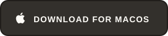
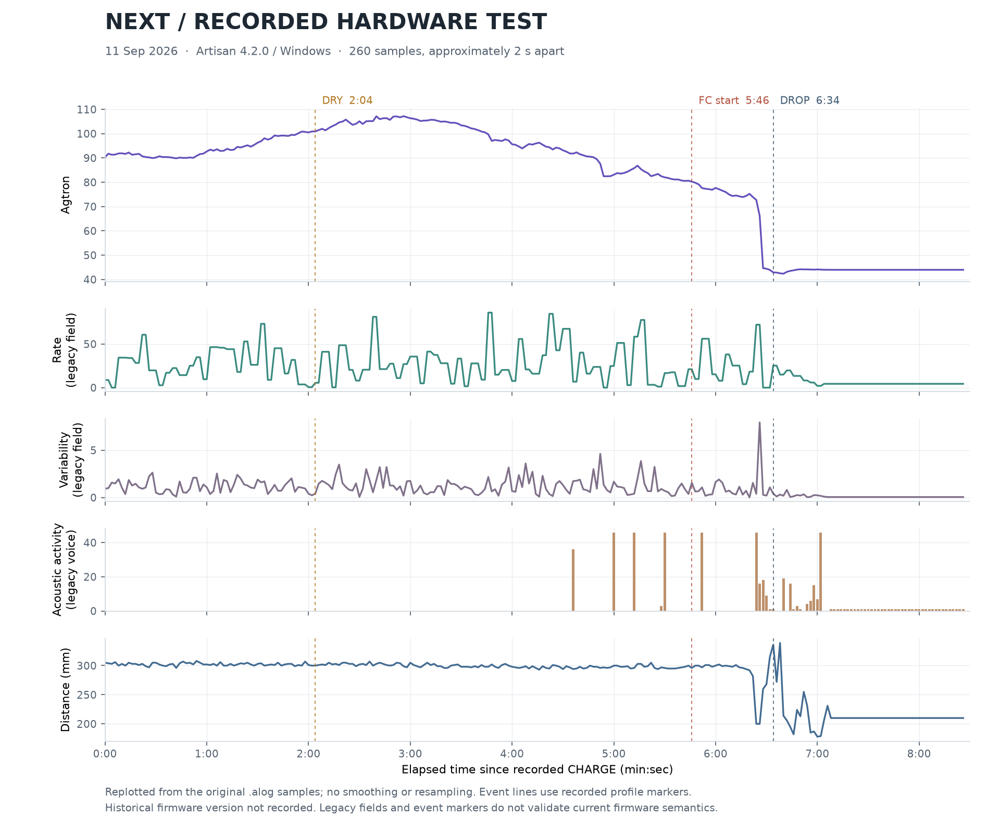
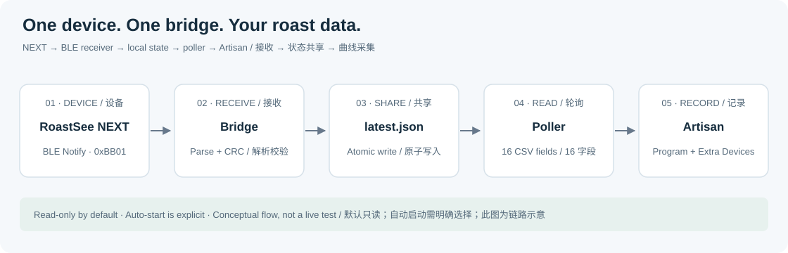
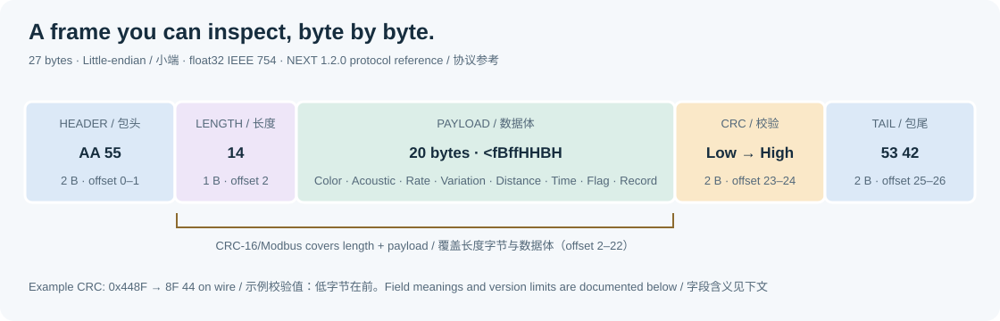

<a href="https://lebrewtech.com/">
  <picture>
    <source media="(prefers-color-scheme: dark)" srcset="assets/brand/lebrew-wordmark-dark.png">
    
  </picture>
</a>

RoastSee NEXT → Artisan
======================

A standalone BLE bridge for coffee-roasting data.

> **Why a standalone bridge?** Under LeBrew’s current support arrangement, the Artisan team will no longer handle fixes for RoastSee NEXT-specific integration issues. LeBrew handles ongoing support through this bridge. Please report Bluetooth, sampling, and device compatibility issues in [this repository’s Issues](https://github.com/lebrew-tech/RoastSee-NEXT-Artisan-Bridge/issues).

> **Supported NEXT firmware for live data: 1.1.4–1.1.8 and 1.2.0–1.2.4, inclusive.** Check **About / Info → Kernel Version** on your NEXT. Samples from all ten versions passed offline decoding and Artisan Program formatting. See [firmware compatibility](#next-firmware-compatibility) for the test scope.

[](README.md)
[](README.zh-CN.md)

<p align="center">
  <a href="https://github.com/lebrew-tech/RoastSee-NEXT-Artisan-Bridge/releases/download/desktop-2026-11-23/RoastSeeNEXT-Artisan-Windows-x64-Setup.exe">
    
  </a>
  <a href="https://github.com/lebrew-tech/RoastSee-NEXT-Artisan-Bridge/releases/download/desktop-2026-11-23/RoastSeeNEXT-Artisan-macOS-universal2.zip">
    
  </a><br>
  Windows x64 · One Mac download for Intel and Apple Silicon · No Python installation needed
</p>


[](https://github.com/lebrew-tech/RoastSee-NEXT-Artisan-Bridge/releases/latest)
[](LICENSE)

[Download](https://github.com/lebrew-tech/RoastSee-NEXT-Artisan-Bridge/releases/latest) · [Desktop setup and recording](#desktop-guide) · [Manual Artisan settings](#artisan-settings) · [Recorded test](#recorded-test) · [Firmware compatibility](#next-firmware-compatibility) · [Packet reference](#packet-reference) · [Known limits](#diagnostics-and-known-limits)

<a id="quick-start"></a>

<a id="windows-desktop-app"></a>
<a id="macos-quick-start"></a>
<a id="desktop-guide"></a>

## Desktop setup and recording

### First-time installation and setup

1. Install the [Artisan roast logger](https://artisan-scope.org/download/). If Artisan is open, save your current roast and quit. Turn on Bluetooth on your computer.
2. Open the bridge for your platform.

   - **Windows 10/11 x64.** Download and double-click the [Windows installer (EXE)](https://github.com/lebrew-tech/RoastSee-NEXT-Artisan-Bridge/releases/download/desktop-2026-11-23/RoastSeeNEXT-Artisan-Windows-x64-Setup.exe). Select **Install**, leave “Launch RoastSee NEXT for Artisan” selected, and click **Finish**. On later runs, open **RoastSee NEXT for Artisan** from the Start menu.
   - **Mac (Intel or Apple Silicon).** Download the [universal Mac ZIP](https://github.com/lebrew-tech/RoastSee-NEXT-Artisan-Bridge/releases/download/desktop-2026-11-23/RoastSeeNEXT-Artisan-macOS-universal2.zip), extract it to a folder you plan to keep, and double-click **`RoastSeeNEXTBridge.app`**. If macOS blocks the first launch, see [First launch on macOS](#mac-first-launch).

3. In the **bridge window**, use the top-right menu to choose **English** or **简体中文**. Click **Set up and open Artisan**. If asked to locate Artisan, choose the installed `artisan.exe` on Windows or `Artisan.app` on Mac.
4. Confirm the input change. The bridge backs up the affected settings, switches Artisan’s main ET/BT input to **Prog**, and opens Artisan. This temporarily replaces your roaster’s temperature input. **Program 34** (Agtron and acoustic activity) and **Program 56** (Agtron rate and variation) now show readings and curves. On later runs, just click **Open Artisan**.

### How to connect and record a roast

1. **Connect in the bridge.** Turn on NEXT, disconnect any phone app using it, and click **Connect NEXT**. On Mac, allow Bluetooth access if prompted. Keep the bridge window open.
2. **Start measurement on NEXT.** Open the device’s live-roasting screen and press **Start**. When the bridge says **Receiving live readings** and the Agtron value updates, data is reaching the computer. For automatic start, select **Start measurement on connection** before connecting.
3. **Monitor and record in Artisan.** Click **ON** to see the extra-channel readings. Click **START** when you want to record this roast. ET/BT can show `-1` because the NEXT live packet carries no temperature.
4. **Finish and save.** In Artisan, click **OFF** to stop recording and save the roast profile (`.alog`) from the **File** menu. Then stop measurement on NEXT and click **Disconnect** in the bridge. [Artisan Quick-Start Guide](https://artisan-scope.org/docs/quick-start-guide/)

### If readings or curves are missing

| What you see | What to do |
| --- | --- |
| The bridge keeps searching | Check that NEXT is on, the phone app is disconnected and Bluetooth is enabled. On Mac, check System Settings → Privacy & Security → Bluetooth. |
| The bridge is connected but its readings show `—` | Press **Start** on the NEXT live-roasting screen and wait for a numeric Agtron reading in the bridge. |
| Agtron updates in the bridge but Artisan has no curve | Click **ON** in Artisan. If the extra channels are blank, quit Artisan and select **Set up and open Artisan** in the current bridge. If it already says **Open Artisan**, open it and check [Program 34 and 56](#artisan-settings). If values appear, adjust **Config → Axes** so the Agtron values are within the vertical range. |

**To switch back to your roaster**, save your roast, quit Artisan, click **Restore settings** in the bridge and confirm. Reopen Artisan. Restore these settings before uninstalling the bridge. If you move the portable app or switch from the old ZIP to the installer, run setup from the new location to update the sampler path.

For a portable copy, [download the Windows ZIP](https://github.com/lebrew-tech/RoastSee-NEXT-Artisan-Bridge/releases/download/desktop-2026-11-23/RoastSeeNEXT-Artisan-Windows-x64.zip), extract the entire folder, double-click `RoastSeeNEXT-Artisan.exe`, and continue with the configuration steps above.

### Mac command-line use (optional)

The same folder includes `START_HERE.command` for receive-only mode, `START_LIVE.command` for automatic measurement, and `artisan_next_poll` for [manual Artisan setup](#artisan-settings). The desktop receiver writes `~/Library/Application Support/RoastSeeNEXT/desktop-latest.json` and the command-line receiver writes `~/Library/Application Support/RoastSeeNEXT/latest.json`. Use `./START_HERE.command --log-level DEBUG` to troubleshoot or pass `--mock-live --state FILE` for an offline test. Read the same file with `./artisan_next_poll --state FILE`.

<a id="mac-first-launch"></a>

### First launch on macOS

The desktop package is ad-hoc signed and has no Apple notarization. If macOS blocks the app at first launch and you trust the source and integrity of this copy, follow [Apple’s Open Anyway instructions](https://support.apple.com/102445) for the app. Bluetooth access is requested when you connect. You can review access in **System Settings → Privacy & Security → Bluetooth**.

<a id="artisan-settings"></a>

## Manual Artisan setup

**Use the same Artisan settings on Windows and Mac. Add two extra-device groups: `Program 34` and `Program 56`, giving four readings in total. Add `Program 78` if you also need distance.** Each Program group contains two channels; the setup is not limited to two readings.

1. **Save your configuration:** choose **Help → Save Settings** in Artisan. This setup changes the main input to **Prog**; an existing roaster temperature connection needs separate configuration.
2. **Enable expert mode:** open **Config → Mode → Expert**, then **Config → Device** and select **Prog** as the input.
3. **Select the poller:** use the upper **Select** button in **External Program** and choose the file below from the extracted folder. **Leave the lower Output checkbox unchecked.** Do not select the receiver or a startup script.

| System | File to select as External Program |
| --- | --- |
| Windows | `artisan_next_poll.exe` |
| Mac (Intel / Apple Silicon) | `artisan_next_poll` (no suffix; not the `.app`) |

4. **Add channels:** add the groups below in **Extra Devices**. Enable **LCD** for numeric readings and **Curve** for plots on each channel you want to see. The dropdown displays names such as `Program 34`, without a leading `+`.

| Extra-device group | First channel | Second channel | Recommendation |
| --- | --- | --- | --- |
| `Program 34` | Agtron | Acoustic activity (`voice`) | Add |
| `Program 56` | Agtron rate | Agtron variability | Add |
| `Program 78` | Distance | Bridge-latched time, not a validated yellow time | Add for distance |
| `Program 910` | Bridge-generated flag, not validated for automatic DRY | Unused | Leave out for now |

5. **Monitor and record:** keep the bridge window open, start live measurement on NEXT, and wait for `received live sample`. In Artisan, click **ON** to monitor, then **START** to record. Press **Ctrl+C** to exit the bridge; stop measurement on the NEXT itself.

**What should you see?** Check the extra channels for Agtron and acoustic readings. Binary live frames contain no temperature, so **ET / BT values of `-1` are expected**. The stock Program interface reads only the first **10 columns** and has no `Program 1112 / 1314 / 1516` devices. This setup cannot directly display the FC/SC extension fields or provide reliable automatic yellow tagging. See the [official External Programs help](https://github.com/artisan-roaster-scope/artisan/blob/master/src/help/programs_help.py).

<a id="recorded-test"></a>

## 📈 Recorded hardware test: the first NEXT session

This chart is replotted from the original samples in `NEXT第一次测试.alog`, recorded on **11 September 2026** with **Artisan 4.2.0 / Windows**. The profile used **Program 34 / 56 / 78 / 910** extra devices and contains **260 samples, approximately two seconds apart**, covering Agtron, rate, the legacy variability field, acoustic activity, and distance.



Time is relative to the profile's recorded CHARGE marker. Vertical lines show its saved **DRY at 2:04, first-crack start at 5:46, and DROP at 6:34**. No additional smoothing or resampling was applied. [Download the plotted values as CSV](assets/examples/next-roast-2026-09-11.csv), including all samples and pre-charge readings, with only numeric chart data retained.

**This is a replot of a historical hardware recording, not a screenshot of the current Artisan interface.** The NEXT firmware version and how the event markers were entered were not recorded. The markers do not establish automatic event detection; historical acoustic and variability fields do not validate firmware 1.2.0 semantics or every feature of the current release.

## ☕ Summary

This tool connects LeBrew RoastSee NEXT to **[Artisan](https://artisan-scope.org/)**, an open-source application for recording and examining coffee roast profiles. The bridge receives NEXT readings over Bluetooth LE and presents them through Artisan's external **Program** interface. Install Artisan separately; its [source code](https://github.com/artisan-roaster-scope/artisan), [downloads](https://artisan-scope.org/download/), and [documentation](https://artisan-scope.org/docs/) are maintained by the Artisan team.

Start live measurement on the NEXT and the bridge sends its readings to Artisan. Mark the yellow point (DRY) manually in Artisan. The bridge’s yellow channels do not reliably identify this event.

## 🌐 Related tools

| Tool | GitHub / download | What it is for |
| --- | --- | --- |
| NEXT web console | [RoastSee NEXT Console](https://github.com/lebrew-tech/RoastSee-NEXT-Console) | A separate browser-based NEXT interface; firmware command compatibility must be checked independently. |
| One-click firmware updater | [LEBREW Firmware Updater](https://github.com/lebrew-tech/LEBREW-Firmware-Updater) · [Downloads](https://github.com/lebrew-tech/LEBREW-Firmware-Updater/releases/latest) | A separate guided utility for product selection, firmware download and flashing. |
| Artisan | [Artisan source](https://github.com/artisan-roaster-scope/artisan) · [Downloads](https://artisan-scope.org/download/) | The roast-recording application receiving this bridge's Program output. |

The bridge package contains no firmware. If you use the updater, select your NEXT model and check the installed Kernel Version against the table below.

<a id="next-firmware-compatibility"></a>

## 🔎 NEXT firmware compatibility

NEXT firmware versions, hardware revisions, and bridge release numbers are separate. Check the NEXT's **About / Info** page and read **Kernel Version (内核版本)** before selecting a setup. The bridge does not query firmware versions automatically and does not include a firmware image or updater.

| NEXT firmware | How live-data compatibility was checked |
| --- | --- |
| **1.1.4–1.1.8** | The bridge decoded 27-byte BLE frames from the 1.1.4–1.1.7 firmware encoders and the example in the 1.1.8 protocol specification. |
| **1.2.0–1.2.4** | The same check passed with frames from the 1.2.0 and 1.2.2–1.2.4 encoders and the example in the 1.2.1 firmware acceptance record. |
| Other versions | Outside the verified range. |

Once you have checked your version, follow [Desktop setup and recording](#desktop-guide) to record your first roast.

Each sample produced the expected color, acoustic activity, rate of change and distance in Artisan Program output. These were offline checks. A complete roast from NEXT to Artisan has yet to be verified on hardware for each version. The historical recording above does not identify its firmware.

Firmware 1.2.0 is the reference for the field descriptions below. The meaning of the yellow and variability fields can change across versions. Artisan needs Program / +Program channels. The minimum Artisan version for this setup has yet to be verified on hardware.

## 💡 Why this project exists

This bridge began as a practical integration tool during LeBrew's work with the Artisan team in September 2026. The immediate goal was to make the NEXT enter live measurement, receive its BLE readings, and expose them through Artisan's existing **Program** channels, without changing or rebuilding Artisan.

Subsequent integration discussions with Marko Luther clarified two distinct issues: starting a BLE connection does not always start measurement, and NEXT color/acoustic/distance data belong in **Extra Devices**, while Artisan's ET/BT channels are for roasting-machine temperatures. Firmware versions also accept different command sets. This motivated an explicit startup mode, visible connection logs, and a documented field mapping.

Early integration testing found that firmware versions accept different page-control commands. Use the compatibility table here to check your firmware and the field mapping.

Artisan also offers native NEXT support. This project remains a standalone compatibility, debugging, and protocol-reference tool. Native integration may be the simpler option for a supported device/software combination; see [Artisan's LeBrew device page](https://artisan-scope.org/devices/lebrew/). This repository is maintained by LeBrew and is separate from the Artisan project.

## 🔗 At a glance

| Capability | Behavior |
| --- | --- |
| Receive | BLE notifications from `RoastSeeNEXT`, characteristic `0xBB01` |
| Validate | Binary length, tail, CRC; ASCII syntax and numeric representation |
| Share | Atomically replace a local JSON state file |
| Integrate | Print one line of 16 comma-separated fields for Artisan Program |
| Start | Read-only by default; optional `roasting` then `start` commands |
| Run | Windows x64 or one macOS Universal 2 package for both chip families; Python source is also available |



> **Field meanings depend on the firmware.** The parser accepts the 27-byte BLE frames listed above and two ASCII formats. See the yellow-time and variability notes below when interpreting these channels.

<a id="setup-details"></a>

## 🧭 Detailed setup

### 1 · Windows command-line mode

Download the Windows ZIP from [Releases](https://github.com/lebrew-tech/RoastSee-NEXT-Artisan-Bridge/releases), then **extract the entire folder**. Keep `_internal` beside the executables. No separate Python or pip installation is needed for this bundle. Use Windows 10/11 x64 with Bluetooth LE support; this build was checked on Windows 11.

| File | Purpose |
| --- | --- |
| `RoastSeeNEXT-Artisan.exe` | Open the desktop app to set up or restore Artisan and connect to NEXT. |
| `START_HERE.cmd` | Receive only; start measurement manually on the NEXT |
| `START_LIVE.cmd` | Enter the live screen and start measurement automatically |
| `RoastSeeNEXTBridge.exe` | Long-running receiver; keep it open |
| `artisan_next_poll.exe` | Short-lived program Artisan calls for each sample |
| `_internal/` | Bundled Python runtime and Bluetooth dependencies |

1. Turn on Windows Bluetooth. Close phone apps, nRF Connect, and other clients holding the NEXT connection.
2. Run `START_HERE.cmd` or explicitly choose `START_LIVE.cmd`.
3. Power on the NEXT. In read-only mode, manually enter its live roasting screen and start measurement.
4. Wait for `subscribed to ...bb01...` and `received live sample`.
5. Configure Artisan as below, then click **ON**. Stop the receiver with **Ctrl+C**.

`START_LIVE.cmd` writes `roasting\r\n`, waits 1.5 seconds for the page change, then writes `start\r\n`. It starts live measurement on the device. Closing the bridge does not send a stop command; stop measurement on the device when needed.

### 2 · Configure Artisan

Save your current Artisan configuration using **Help → Save Settings** first. This standalone setup selects **Prog** as the input, replacing the current main-device selection. It does not combine the bridge with an existing roaster temperature connection.

Open **Config → Mode → Expert**, then **Config → Device**. Select the **Prog** radio button. In **External Program**, use the upper **Select** button to choose `artisan_next_poll.exe` on Windows, or the extracted folder's `artisan_next_poll` on Mac. Leave the separate **Output** checkbox unchecked. For example, a Windows path is:

```text
"C:\Tools\RoastSeeNEXT-Artisan-Windows-x64\artisan_next_poll.exe"
```

Add the following **Extra Devices** and enable each desired **LCD** and/or **Curve**:

| Device | Channel 1 | Channel 2 |
| --- | --- | --- |
| `Program 34` | Agtron | Acoustic activity (`voice`) |
| `Program 56` | Agtron rate | Agtron variability (legacy filtered field) |
| `Program 78` | Distance | Bridge-latched time (not a validated yellow time) |
| `Program 910` | Bridge-generated flag (not validated for DRY) | Unused |

Add **Program 34 + Program 56**, and optionally **Program 78** for distance; the full walkthrough is in [Artisan settings above](#artisan-settings). Artisan removes the leading `+` from extra-device names in the dropdown. The current official Program interface reads only the first **10 values**, and does not provide Program 1112 / 1314 / 1516 devices. The bridge's FC/SC values in raw columns 11–16 therefore do not appear through this setup. See the [official External Programs help](https://github.com/artisan-roaster-scope/artisan/blob/master/src/help/programs_help.py).

The NEXT live binary frame has no temperature. **ET and BT are `-1`**. A zero or missing temperature curve does not establish whether the NEXT data arrived; inspect its Extra Device channels and bridge logs. The 8-field ASCII extension can supply ET.

<a id="packet-reference"></a>

## 📡 Packet reference

### BLE transport

| Item | Value |
| --- | --- |
| Advertised local name | `RoastSeeNEXT` (receiver also accepts names containing it) |
| Service | `000000bb-0000-1000-8000-00805f9b34fb` |
| Read / Write / Notify characteristic | `0000bb01-0000-1000-8000-00805f9b34fb` |
| Notify descriptor | CCCD `0x2902`; enable notifications before waiting for data |
| Optional startup writes | ASCII `roasting\r\n`, then `start\r\n` |

The receiver scans and establishes GATT itself; pairing in Windows Settings is not required. Notifications may split one frame or carry multiple frames, so the live parser buffers data across notifications. This bridge handles live frames and complete event summaries; it does not download history or parse all firmware command/event messages.

### Binary live frame · 27 bytes

All offsets below start at zero. Multibyte payload values and the CRC are **little-endian**. Floats are IEEE 754 binary32. The packed payload is equivalent to Python `struct` format **`<fBffHHBH`**, with no padding.



```text
AA 55 │ 14 │ 20-byte payload │ CRC low CRC high │ 53 42
 2 B    1 B        20 B              2 B           2 B
```

| Frame offset | Bytes | Type | Field / meaning in inspected 1.2.0 firmware |
| --- | ---: | --- | --- |
| 0–1 | 2 | Fixed | Header `AA 55` |
| 2 | 1 | `uint8` | Payload length `0x14` = 20; excludes envelope and CRC |
| 3–6 | 4 | `float32` | `curve_agtron`: live color value, Agtron scale |
| 7 | 1 | `uint8` | `voice`: acoustic event activity; see notes below |
| 8–11 | 4 | `float32` | `agtron_rate`: magnitude of color change, Agtron units/min |
| 12–15 | 4 | `float32` | `weighted_median_mean_agtron`: variability, despite the legacy name |
| 16–17 | 2 | `uint16` | `distance`: laser distance, mm |
| 18–19 | 2 | `uint16` | `time_yellow`: transmitted roast elapsed time in seconds; see mismatch below |
| 20 | 1 | `uint8` | `flag_yellow`: firmware yellow indication; bridge rewrites this field |
| 21–22 | 2 | `uint16` | `cnt_record`: roast record number; bridge output slot is unused |
| 23–24 | 2 | `uint16` | CRC-16/Modbus, low byte first |
| 25–26 | 2 | Fixed | Tail `53 42` |

**Parameter interpretation.** These meanings were checked against the 1.2.0 source; older firmware can differ.

- `voice` is a per-sample acoustic activity signal derived from a rolling one-second event density, gated around yellow detection and scaled for transmission. It is not calibrated dB, a cumulative crack count, or a reliable standalone first-crack trigger. The bridge forwards received values without extra smoothing.
- `agtron_rate` is calculated as `abs(color_3_seconds_ago - current_color) * 20`. The magnitude loses the direction of color change.
- `weighted_median_mean_agtron` is currently calculated as `4 * IQR / 3` over a 20-point window. It describes color variability, not a smoothed absolute Agtron value and not another rate. Historical labels such as “Filtered Agtron” or “FoR” can be misleading.
- `cnt_record` increments when a roast starts; it is not a per-frame sample sequence. The bridge deliberately outputs `-1` in Artisan slot 10.
- **Yellow mismatch:** the inspected firmware sends elapsed roast seconds as `time_yellow`. The existing bridge instead latches the first nonzero value and emits a single flag, resetting when the incoming value returns to zero. It also replaces the incoming `flag_yellow`. Therefore slots 8/9 are not reliable true yellow-event markers with this firmware. Do not configure automatic DRY tagging from them without resolving and validating that difference.

### CRC and a complete example

Use CRC-16/Modbus: initial value `0xFFFF`, reflected polynomial `0xA001`, no final XOR. Cover **offsets 2 through 22 inclusive**: the length byte plus the 20-byte payload. Exclude header, CRC bytes, and tail.

This synthetic frame represents color `84.6`, voice `3`, rate `1.2`, variability `84.9`, distance `327`, time `95`, flag `1`, record `12`. Values demonstrate decoding and are not a measured roast:

```text
AA 55 14 33 33 A9 42 03 9A 99 99 3F CD CC A9 42
47 01 5F 00 01 0C 00 8F 44 53 42
```

The CRC is **`0x448F`**, transmitted as **`8F 44`**. Float32 values may decode slightly above/below their decimal examples. The parser requires a matching length, tail and CRC before accepting a binary frame. It does not additionally validate physical sensor ranges or reject nonfinite binary floats.

### Compatible ASCII live formats

The receiver also accepts comma-separated ASCII terminated by `\r\n` or NUL (`00`). These formats have no CRC. Seven fields:

```text
CurveAgtron,Voice,AgtronRate,LegacyFilteredField,Distance,TimeYellow,FlagYellow
84.6,3,1.2,84.9,327,95,1\r\n\0
```

The eight-field extension prepends ET:

```text
ET,CurveAgtron,Voice,AgtronRate,LegacyFilteredField,Distance,TimeYellow,FlagYellow
45.5,84.6,3,1.2,84.9,327,95,1\r\n\0
```

The parser checks field count, finite numbers and integer-valued voice/distance/time/flag fields. It does not enforce physical ranges or a Boolean-only flag. Seven-field data get ET `-1`; both ASCII formats set the unused record value to `-1`. The ASCII examples are compatibility/test data, not a claim that 1.2.0 sends text live frames. The firmware's UART text with a trailing record number is a different eight-field layout and must not be fed into this ET-first format.

### Roast-end event summary · ASCII

The summary is a separate message, not a live sample. The parser expects text starting with `Y_time:` and all 12 named values. For example:

```text
Y_time:95,Y_agtron:84.6,Y_ROR:1.2,FC_time:180,FC_agtron:72.0,FC_ROR:2.3,SC_time:240,SC_agtron:60.5,SC_ROR:1.1,D_time:300,D_agtron:55.0,D_ROR:0.8
```

| Prefix / suffix | Meaning |
| --- | --- |
| `Y_` | Yellow event |
| `FC_` | First crack event |
| `SC_` | Second crack event |
| `D_` | Drop / roast-end event |
| `time` | Event time from roast start, seconds |
| `agtron` | Color value at the event |
| `ROR` | Color change rate at the event, firmware-supplied |

Separators/whitespace can vary because values are matched by key. The parser ignores bytes after the first NUL or `A5` padding byte. It requires the **entire summary in one notification**; split summaries are not reassembled. All four events enter JSON; FC/SC values also occupy raw poller columns 11–16, which the current official Artisan Program interface does not consume. Summary `Y_time` is stored as `yellow_time`, distinct from live `time_yellow`, so it does not correct columns 8/9. Reported event values are not a guarantee of automatic event detection.

## 📊 Raw poller output · 16 fields

The poller writes exactly one CSV line with a trailing newline; diagnostic logging belongs to the receiver. **Current official Artisan reads columns 1–10; columns 11–16 are raw extensions, not configurable stock Program channels.** Slots are one-based:

| Slot | Meaning | Format / fallback |
| ---: | --- | --- |
| 1 | ET, only available in eight-field ASCII | 3 decimals; otherwise `-1.000` |
| 2 | BT | Always `-1` |
| 3 | Live Agtron | 3 decimals |
| 4 | Raw received acoustic activity | Integer |
| 5 | Agtron rate | 3 decimals |
| 6 | Legacy filtered / current variability field | 3 decimals |
| 7 | Distance, mm | Integer |
| 8 | Bridge-latched yellow-time field | Integer; see yellow mismatch |
| 9 | Bridge-generated one-sample yellow flag | Integer; see yellow mismatch |
| 10 | Unused record slot | Always `-1` |
| 11 | FC time, seconds | Integer |
| 12 | FC Agtron | 3 decimals |
| 13 | FC ROR | 3 decimals |
| 14 | SC time, seconds | Integer |
| 15 | SC Agtron | 3 decimals |
| 16 | SC ROR | 3 decimals |

Example before receiving an event summary:

```text
-1.000,-1,84.600,3,1.200,84.900,327,95,1,-1,-1,-1.000,-1.000,-1,-1.000,-1.000
```

Missing, unreadable, or invalid-JSON state yields sixteen `-1` placeholders. On Windows the desktop app uses `desktop-latest.json` in the same folder. The command-line default is `%LOCALAPPDATA%\RoastSeeNEXT\latest.json` on Windows. Both programs accept `--state PATH`; use the same path for both. This file contains the latest reading, not a time series.

<a id="diagnostics-and-known-limits"></a>

## 🛠️ Diagnostics and known limits

| Symptom | Check |
| --- | --- |
| Device not found | Bluetooth enabled, NEXT powered on, other BLE clients disconnected |
| Subscribed but no readings | Device in live screen and measuring; try explicit `START_LIVE.cmd` |
| Data in logs but no curves | Program path, Extra Devices, LCD/Curve flags; inspect extra channels |
| Only `-1` values | Receiver has not written valid state, or poller uses another state path |
| Lost connection but values remain | State has no freshness timeout; last values remain available |

Run `RoastSeeNEXTBridge.exe --log-level DEBUG` to inspect actual notification hex. Avoid guessing the protocol from a connection-success message alone.

The following limits apply to the documented bridge protocol and sampling path.

- Offline checks cover parsing, storage, poller output and frozen Windows backend imports. Actual BLE reception and an Artisan roasting session have **not** been verified for this release.
- A new live sample replaces the state, so a summary's FC/SC values can disappear if live data resume. A short yellow pulse can also be missed by a slower Artisan poll interval.
- State has no age, device ID, or schema validation. Do not mix receivers/devices on one path. Invalid JSON returns placeholders; a manually edited JSON object with wrong field types can make the poller fail.
- Reconnection scans again and selects a matching device by name; there is no address selector. History export, firmware flashing, and full device control are outside this bridge.
- Native packages cover Windows x64 and macOS Universal 2. The Mac desktop package contains arm64 and x86_64 slices. Linux hardware behavior has not been validated here.

### Offline self-check

From an extracted bundle in PowerShell, use an isolated state file:

```powershell
$testState = Join-Path $env:TEMP ('NEXT-test-' + [guid]::NewGuid() + '.json')
.\RoastSeeNEXTBridge.exe --state $testState --mock-live
.\artisan_next_poll.exe --state $testState
Remove-Item -LiteralPath $testState
```

The output must match the example above. This writes no data to the real bridge state and needs no device.

## 🧰 Run from source / build

> **Build provenance.** The repository scripts below build the command-line package. The macOS desktop download on the release page comes from a separate Mac build.

From the repository root with Python 3.10+:

```powershell
python -m pip install -r requirements.txt
python -m next_artisan_bridge.next_ble_bridge --state "$env:LOCALAPPDATA\RoastSeeNEXT\latest.json"
python -m next_artisan_bridge.artisan_next_poll
python -m unittest discover -s next_artisan_bridge/tests -v
```

Add `--auto-start-live` to the receiver only when automatic measurement startup is intended. The receiver runs until interrupted; use another terminal for polling.

To reproduce the Windows x64 bundle, use Windows x64 Python 3.12, install runtime requirements and `pyinstaller==6.22.3`, then run:

```powershell
powershell -ExecutionPolicy Bypass -File packaging/windows/build_windows.ps1
```

To create the Windows installer, complete the Windows build above, then run `ISCC.exe packaging/windows/installer.iss` with Inno Setup 6.4 or later. The installer is written to `dist/windows/`.

The script runs the regression tests, builds the desktop and command-line programs with a shared runtime, checks the frozen offline data path, and writes the ZIP under `dist/windows/`. Dependency license notices are included in the bundle. See [LICENSE](LICENSE) for the project's MIT license.

On a Mac with python.org's Universal 2 Python 3.12 and universal runtime dependencies installed, install `pyinstaller==6.22.3`, then run `bash packaging/macos/build_macos.sh`. It builds Universal 2, adds the Bluetooth permission description, checks the signature and mock/poll data path, verifies both CPU slices in every Mach-O file, and creates a ZIP under `dist/macos/` with launcher permissions preserved. The GitHub Actions workflow extracts and tests that same ZIP separately on Apple Silicon and Intel before publishing it alongside the Windows package.

### Repository layout

```text
next_artisan_bridge/       Bridge source
  tests/                  Protocol, storage and state-path tests
packaging/
  windows/                Windows build, launchers and bundle check
  macos/                  Universal 2 build, launchers and Mac checks
  common/                 Shared poller entry point
assets/
  brand/                  LeBrew wordmarks and application icon
  buttons/                English and Chinese download buttons
  diagrams/               Data-flow and packet illustrations
  examples/               Historical hardware chart and numeric CSV
licenses/                 Third-party license texts
.github/workflows/        Native build and release workflow
build/                    Temporary build files (not committed)
dist/                     Generated/downloaded packages (not committed)
  windows/                Windows bundle and ZIP
  macos/                  Universal Mac bundle and ZIP
  releases/<version>/     Downloaded release archives
```

The bilingual READMEs, project license and dependency notices remain at the repository root. Downloaded packages keep their launchers and user guides at the top level for easy access.

## 🗓️ Version history

| Bridge version | Date | Changes |
| --- | --- | --- |
| macOS desktop | 2026-11-20 | Adds a double-click app, Artisan setup and restore, four live readings, and English / Simplified Chinese switching. |
| v0.2.3 | 2026-11-05 | Organizes packaging by platform and artwork by purpose, with platform-specific build output folders. User launchers are unchanged. |
| v0.2.2 | 2026-11-05 | One Mac Universal 2 download for Intel and Apple Silicon, with the same archive checked on both architectures. |
| v0.2.1 | 2026-11-05 | Adds native Mac packaging, Bluetooth permission text, Mac launchers, a fixed shared state path, and simple Mac instructions. |
| main | 2026-11-05 | Adds direct Windows and universal Mac download buttons to both READMEs. |
| v0.1.2 | 2026-11-05 | Adds bilingual data-flow and packet diagrams, plus section icons and stable navigation anchors. Executables are unchanged. |
| v0.1.1 | 2026-11-05 | Clarifies NEXT firmware compatibility and integration background; adds LeBrew branding and Artisan links to both guides. Executables are unchanged from v0.1.0. |
| v0.1.0 | 2026-11-05 | First public Windows portable package, bilingual setup guide, and packet reference. |

## 🤝 Acknowledgements

Thanks to Marko Luther and the [Artisan team](https://github.com/artisan-roaster-scope/artisan) for their integration work, testing feedback, and clarification of extra-channel behavior. The concise title, release badges, summary, and version-history structure of this README take inspiration from [Artisan's README](https://github.com/artisan-roaster-scope/artisan#readme). Artisan is a separate project with its own license; this bridge's MIT license applies to the bridge code.
