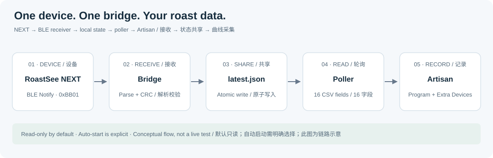
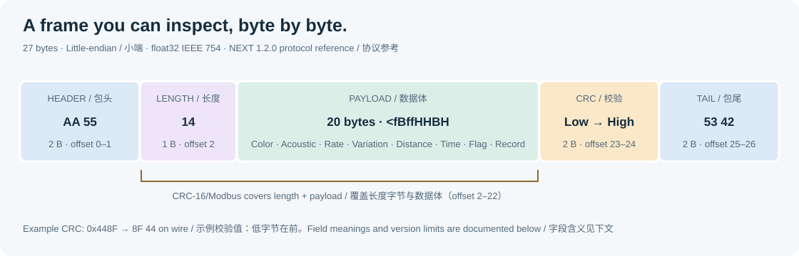

<a href="https://lebrewtech.com/">
  <picture>
    <source media="(prefers-color-scheme: dark)" srcset="assets/lebrew-wordmark-dark.png">
    
  </picture>
</a>

RoastSee NEXT → Artisan
======================

独立运行的咖啡烘焙数据 BLE 桥接程序。

[](README.md)
[](README.zh-CN.md)


[](https://github.com/lebrew-tech/RoastSee-NEXT-Artisan-Bridge/releases/latest)
[](LICENSE)

[下载](https://github.com/lebrew-tech/RoastSee-NEXT-Artisan-Bridge/releases/latest) · [固件兼容性](#next-固件兼容性) · [快速上手](#快速上手) · [数据包参考](#数据包参考) · [排查与已知限制](#排查与已知限制)

<a id="快速上手"></a>

## 🚀 四步开始使用

**Windows x64 · 目标 NEXT 固件：1.2.0。** 旧版未确认为支持；实机验证情况与黄点限制见[版本说明](#next-固件兼容性)。

1. **下载并完整解压** [Windows ZIP 包](https://github.com/lebrew-tech/RoastSee-NEXT-Artisan-Bridge/releases/latest)。保留整个文件夹，不需要安装 Python。
2. **启动桥接。** 打开电脑蓝牙，关闭连接 NEXT 的手机 App，运行 `START_HERE.cmd`；在 NEXT 上进入实时烘焙页并开始测量。保持桥接窗口打开，等日志出现 `received live sample`。
3. **配置 Artisan。** 先保存原配置，再进入 **Config → Mode → Expert**，然后 **Config → Device → Program**；将 **External Program** 设为解压目录内 `artisan_next_poll.exe` 的完整路径。这会改变主设备选择。
4. **显示曲线。** 在 **Extra Devices** 添加 **`+Program 34`**，打开色值和声音通道的 **LCD / Curve** 开关，然后在 Artisan 点击 **ON**。

**停止：** 在桥接窗口按 **Ctrl+C**。其他数据通道和自动启动测量的方式见[详细配置](#详细配置)。

## ☕ 简介

本工具将 LeBrew RoastSee NEXT 接入 **[Artisan](https://artisan-scope.org/)**。Artisan 是用于记录和分析咖啡烘焙曲线的开源软件；桥接通过 BLE 接收 NEXT 数据，再交给 Artisan 的外部 **Program** 接口。Artisan 需另外安装，其[源码](https://github.com/artisan-roaster-scope/artisan)、[下载](https://artisan-scope.org/download/)和[文档](https://artisan-scope.org/docs/)由 Artisan 团队维护。

**目标适配版本：NEXT 固件 1.2.0。** 支持范围为本文所列 27 字节 BLE 实时帧格式及 Artisan Program 数据输出，依据源码核对与离线测试；本次尚无任何 NEXT 固件版本完成端到端实机认证。黄点通道差异仍未解决，准确自动标记黄点 / DRY 不在支持承诺内。**旧固件和未知版本不列为已确认支持。**

## 🌐 相关软件与下载

| 软件 | GitHub / 下载链接 | 用途 |
| --- | --- | --- |
| NEXT 网页上位机 | [RoastSee NEXT Console](https://github.com/lebrew-tech/RoastSee-NEXT-Console) | 独立的浏览器版 NEXT 操作界面，需另行核对固件命令兼容性。 |
| 一键烧录程序 | [LEBREW Firmware Updater](https://github.com/lebrew-tech/LEBREW-Firmware-Updater) · [下载程序](https://github.com/lebrew-tech/LEBREW-Firmware-Updater/releases/latest) | 独立的型号选择、固件下载与烧录工具。 |
| Artisan | [Artisan 源码](https://github.com/artisan-roaster-scope/artisan) · [下载 Artisan](https://artisan-scope.org/download/) | 接收本桥接 Program 输出的烘焙曲线记录软件。 |

桥接包不附带以上软件或固件。使用烧录工具时，请选择正确的 NEXT 型号，并核对发布目录中实际提供的固件版本，不要把默认“最新版本”自动当作 1.2.0；更新后再次在设备上确认内核版本。

<a id="next-固件兼容性"></a>

## 🔎 NEXT 固件兼容性

NEXT 固件版本、硬件版本和本桥接的 `v0.1.x` 软件版本是三回事。使用前请在 NEXT 的 **About / Info（关于信息）** 页面查看**内核版本（Kernel Version）**。桥接不会自动查询固件版本，也不附带固件或升级器。

| NEXT 固件版本 | 本次开源桥接的适用说明 |
| --- | --- |
| **1.2.0** | 本文二进制布局和参数含义的参考版本。已做源码核对与离线检查；黄点第 8/9 通道不能视为已验证的真实事件标志。 |
| **1.1.5–1.1.8** | 历史联调版本，不代表本次已逐版验证兼容。统一 `NEXT:` 命令从 1.1.5 引入；交流中提到的 1.1.8 当时是内部测试固件，本仓库不提供该固件下载。 |
| **1.1.4 及更早版本** | 旧命令集设备不支持较新的 `NEXT:` 命令。桥接使用旧别名 `roasting` / `start` 启动，但仅凭命令可用不能保证整体兼容或字段含义一致。 |
| 其他 / 未知版本 | 尚未评估；使用前核对版本、实际数据包布局和字段含义。 |

二进制解析器能识别 `AA 55 14 ... CRC ... 53 42` 帧，并不意味着所有固件中每个字段的含义都相同。尤其是已核查 **1.2.0 的 `time_yellow` 和波动量含义与历史描述不同**，请结合下文协议和限制使用。Artisan 侧需要 Program / +Program 通道；本桥接尚未建立经过端到端测试的最低 Artisan 版本要求。

## 💡 为什么开发这个程序

这个桥接程序起源于 2026 年 9 月 LeBrew 与 Artisan 团队的接入联调。当时需要先打通 NEXT 进入实时测量、蓝牙接收和 Artisan 曲线显示这条链路，因此使用 Artisan 已有的 **Program** 通道接入，便于独立验证，无需修改或重新编译 Artisan。

后续与 Marko Luther 的交流进一步明确了两类问题：蓝牙连接成功不一定代表设备已开始测量；NEXT 的色值、距离和声学数据应在 **Extra Devices** 查看，ET/BT 则用于烘焙机温度。此外，不同固件接受的命令集存在差异。这些实际问题促成了明确的启动方式、可观察的连接日志和完整的参数映射说明。

10 月，Marko 在邮件中用 **“AI slub”**（原文，意指“AI 泔水”）批评了早期 [NEXT 网页上位机](https://github.com/lebrew-tech/RoastSee-NEXT-Console)，直率地质疑其完成度和实机可用性：他的 NEXT 可以建立蓝牙连接，但网页发出的页面控制命令在其设备上没有生效。后续排查确认了固件命令集的版本差异——网页按较新的 `NEXT:` 命令集开发，而他持有的设备接受旧版别名。这次反馈促使我们更明确地区分版本前提、协议支持与实机验证，并在本文说明适用边界。该反馈针对当时的网页上位机，不是对本次桥接打包版本的评测。

> 可复现的兼容性问题，我们认真核对；至于形容词，暂时不在固件支持的命令集中。因此，这次把版本前提、数据包格式和未验证的边界写清楚：程序表现可以检查，不必靠一个标签来推断。

Artisan 本身也提供 NEXT 原生支持。本项目继续作为独立的兼容、调试和协议参考工具；设备与软件版本匹配时，原生接入可能更方便。参见 [Artisan 的 LeBrew 设备说明](https://artisan-scope.org/devices/lebrew/)。本仓库由 LeBrew 维护，与 Artisan 项目独立。

## 🔗 功能概览

| 环节 | 行为 |
| --- | --- |
| 接收 | 接收 `RoastSeeNEXT` 的 `0xBB01` 蓝牙通知 |
| 校验 | 二进制长度、包尾、CRC；ASCII 语法和数值表示 |
| 共享 | 原子更新本地 JSON 状态文件 |
| 输出 | 为 Artisan Program 输出一行 16 个逗号分隔的数值 |
| 启动 | 默认只读；可显式发送 `roasting`、`start` 启动测量 |
| 运行 | Windows x64 便携包，或 Python 源码 |



> **字段含义取决于固件。** 桥接支持已核查的 1.2.0 固件所用 27 字节二进制帧，以及两种兼容 ASCII 输入。部分历史字段名与当前含义不同，使用前请阅读下文“黄点”和“波动量”的说明。

<a id="详细配置"></a>

## 🧭 详细配置

### 1 · 解压和连接

从 [Releases](https://github.com/lebrew-tech/RoastSee-NEXT-Artisan-Bridge/releases) 下载 Windows ZIP，**完整解压整个目录**。`_internal` 必须与两个 EXE 一起保留。便携包无需另外安装 Python 或 pip 依赖。电脑需为支持 BLE 的 Windows 10/11 x64；本次构建检查环境为 Windows 11。

| 文件 | 用途 |
| --- | --- |
| `START_HERE.cmd` | 只读接收；在 NEXT 本机手动开始测量 |
| `START_LIVE.cmd` | 自动进入实时页面并启动测量 |
| `RoastSeeNEXTBridge.exe` | 长期运行的接收程序，使用期间保持打开 |
| `artisan_next_poll.exe` | Artisan 每次采样时调用的短程序 |
| `_internal/` | 自带的 Python 运行时及蓝牙依赖 |

1. 打开电脑蓝牙，关闭手机 App、nRF Connect 等占用 NEXT 的连接。
2. 运行 `START_HERE.cmd`；需要自动启动测量时，明确选择 `START_LIVE.cmd`。
3. 打开 NEXT。只读模式下，在设备上进入实时烘焙页并开始测量。
4. 等日志出现 `subscribed to ...bb01...` 和 `received live sample`。
5. 按下文配置 Artisan，然后点击 **ON**。桥接窗口按 **Ctrl+C** 停止。

`START_LIVE.cmd` 会发送 `roasting\r\n`，等待 1.5 秒切页，再发送 `start\r\n`，从而启动设备实时测量。退出桥接不会发送停止命令；需要时请在设备上停止测量。

### 2 · 配置 Artisan

先保存现有 Artisan 配置。下述独立测试接法将**主设备选择改为 Program**，会替换当前主设备选择；它没有同时接入原有烘焙机的温度采集。

进入 **Config → Mode → Expert**，再进入 **Config → Device**。主设备选 **Program**，**External Program** 填写 `artisan_next_poll.exe` 的完整路径，例如：

```text
"C:\Tools\RoastSeeNEXT-Artisan-Windows-x64\artisan_next_poll.exe"
```

在 **Extra Devices** 添加下列设备，并按需要开启各通道的 **LCD** / **Curve**：

| 设备 | 通道 1 | 通道 2 |
| --- | --- | --- |
| `+Program 34` | Agtron 色值 | 声学活动指标 `voice` |
| `+Program 56` | 色值变化率 | 色值波动量，历史名称为滤波字段 |
| `+Program 78` | 距离 | 黄点时间，见兼容性限制 |
| `+Program 910` | 黄点标志，见兼容性限制 | 未使用 |
| `+Program 1112` | 一爆时间 | 一爆色值 |
| `+Program 1314` | 一爆 ROR | 二爆时间 |
| `+Program 1516` | 二爆色值 | 二爆 ROR |

NEXT 实时二进制没有温度字段，**ET、BT 输出为 `-1`**。温度曲线没有变化不能说明 NEXT 没有传数据，应检查 Extra Device 曲线和桥接日志。兼容的 8 字段 ASCII 扩展可以提供 ET。

<a id="数据包参考"></a>

## 📡 数据包参考

### BLE 传输参数

| 参数 | 内容 |
| --- | --- |
| 设备名 | `RoastSeeNEXT`；程序也接受名称中包含该字符串的设备 |
| Service UUID | `000000bb-0000-1000-8000-00805f9b34fb` |
| Read / Write / Notify 特征 UUID | `0000bb01-0000-1000-8000-00805f9b34fb` |
| 通知描述符 | CCCD `0x2902`；接收前必须启用 Notify |
| 可选启动命令 | ASCII `roasting\r\n`，随后 `start\r\n` |

桥接自行扫描并建立 GATT 连接，不要求先在 Windows 设置中配对。一条通知可能只包含半帧，也可能包含多帧；实时解析器会缓存并重组。桥接处理实时帧和完整事件摘要，不下载历史记录，也不解析全部固件命令或事件消息。

### 二进制实时帧 · 共 27 字节

以下偏移从 **0** 开始。多字节数据和 CRC 均为**小端**，浮点数为 IEEE754 binary32。数据体紧凑排列、无填充，对应 Python `struct` 格式 **`<fBffHHBH`**。



```text
AA 55 │ 14 │ 20 字节数据体 │ CRC低字节 CRC高字节 │ 53 42
 2 B    1 B       20 B               2 B            2 B
```

| 整帧偏移 | 字节数 | 类型 | 字段及已核查 1.2.0 固件中的含义 |
| --- | ---: | --- | --- |
| 0–1 | 2 | 固定值 | 包头 `AA 55` |
| 2 | 1 | `uint8` | 数据体长度 `0x14` = 20，不含包头、长度字节、CRC、包尾 |
| 3–6 | 4 | `float32` | `curve_agtron`：实时 Agtron 色值 |
| 7 | 1 | `uint8` | `voice`：声学事件活动指标，见下文 |
| 8–11 | 4 | `float32` | `agtron_rate`：色值变化率的绝对值，Agtron 单位/分钟 |
| 12–15 | 4 | `float32` | `weighted_median_mean_agtron`：当前为色值波动量，名称沿用旧协议 |
| 16–17 | 2 | `uint16` | `distance`：激光距离，毫米 mm |
| 18–19 | 2 | `uint16` | `time_yellow`：当前实际发送累计烘焙秒数，见黄点差异 |
| 20 | 1 | `uint8` | `flag_yellow`：固件黄点标志；桥接会重写该字段 |
| 21–22 | 2 | `uint16` | `cnt_record`：烘焙记录号；Artisan 对应位置固定不用 |
| 23–24 | 2 | `uint16` | CRC-16/Modbus，低字节在前 |
| 25–26 | 2 | 固定值 | 包尾 `53 42` |

**参数含义说明。** 下列结论依据 1.2.0 源码，旧固件可能不同。

- `voice` 来源于滑动 1 秒窗口的声学事件密度，再经过黄点附近的门控和发送缩放。它不是校准后的 dB，也不是累计爆裂次数，不能单独作为可靠的一爆触发条件。桥接不再对收到的数值额外平滑。
- `agtron_rate` 的计算为 `abs(3秒前色值 - 当前色值) * 20`，取绝对值后不保留色值变化方向。
- `weighted_median_mean_agtron` 当前在 20 点窗口计算 `4 * IQR / 3`，代表色值波动程度，不是平滑后的绝对色值，也不是另一条变化率。历史的 “Filtered Agtron” / “FoR” 标签可能引起误解。
- `cnt_record` 在每次开始烘焙时递增，不是每帧递增的采样序号。Artisan 第 10 字段固定输出 `-1`。
- **黄点语义差异：** 当前固件把累计烘焙秒数放进 `time_yellow`。现有桥接却锁存首次非零值，并生成一次标志脉冲；收到时间回零才重置，同时替换了原始 `flag_yellow`。因此，第 8/9 字段不能作为该固件真实的黄点时刻和事件标志，解决并验证这项差异前不要据此自动标记 DRY。

### CRC 与完整数据包示例

CRC-16/Modbus 参数：初值 `0xFFFF`，反射多项式 `0xA001`，最终异或为 0。校验范围为**整帧偏移 2–22（含两端）**，即长度字节和 20 字节数据体，不含包头、CRC 和包尾。

下列模拟帧依次放入色值 `84.6`、声音 `3`、变化率 `1.2`、波动量 `84.9`、距离 `327`、时间 `95`、标志 `1`、记录号 `12`，仅用于说明编码，不是实测烘焙数据：

```text
AA 55 14 33 33 A9 42 03 9A 99 99 3F CD CC A9 42
47 01 5F 00 01 0C 00 8F 44 53 42
```

CRC 为 **`0x448F`**，发送顺序为 **`8F 44`**。float32 解码后与十进制示例出现微小精度差异属于正常情况。解析器校验长度、包尾、CRC 后才接收二进制帧，但没有额外限制传感器物理范围，也没有拒绝二进制中的非有限浮点值。

### 兼容的 ASCII 实时格式

程序还支持以 `\r\n` 或 NUL（`00`）结束、逗号分隔的 ASCII 格式，这类数据没有 CRC。7 字段格式：

```text
CurveAgtron,Voice,AgtronRate,LegacyFilteredField,Distance,TimeYellow,FlagYellow
84.6,3,1.2,84.9,327,95,1\r\n\0
```

8 字段扩展在最前面加入 ET：

```text
ET,CurveAgtron,Voice,AgtronRate,LegacyFilteredField,Distance,TimeYellow,FlagYellow
45.5,84.6,3,1.2,84.9,327,95,1\r\n\0
```

解析器检查字段数、有限数值，以及声音/距离/时间/标志是否为整数，但不检查物理范围，也没有将标志限制为 0/1。7 字段缺少 ET，填 `-1`；两种 ASCII 格式的记录号均填 `-1`。这些是兼容和测试格式，不表示 1.2.0 的 BLE 实时输出为文本。固件 UART 中“末尾附带记录号”的 8 字段文本是另一种布局，不能按这里的 ET 前置格式输入。

### 烘焙结束事件摘要 · ASCII

摘要与实时数据帧分开，解析器要求内容以 `Y_time:` 开头，并包含全部 12 个键值，例如：

```text
Y_time:95,Y_agtron:84.6,Y_ROR:1.2,FC_time:180,FC_agtron:72.0,FC_ROR:2.3,SC_time:240,SC_agtron:60.5,SC_ROR:1.1,D_time:300,D_agtron:55.0,D_ROR:0.8
```

| 前缀 / 后缀 | 含义 |
| --- | --- |
| `Y_` | 黄点事件 |
| `FC_` | 一爆事件 |
| `SC_` | 二爆事件 |
| `D_` | 下豆 / 烘焙结束事件 |
| `time` | 事件发生时距烘焙开始的秒数 |
| `agtron` | 事件时的色值 |
| `ROR` | 事件时由固件给出的色值变化率 |

数值按键名匹配，允许分隔符和空白有所不同。首个 NUL 或 `A5` 后的填充会被忽略。**整个摘要必须在同一次 Notify 回调中完整到达**，当前没有跨通知重组摘要。四类事件都会写入 JSON，只有 FC/SC 六项进入 Artisan 的第 11–16 字段。摘要 `Y_time` 写入 `yellow_time`，与实时 `time_yellow` 是不同键，所以不会纠正第 8/9 字段。存在事件值不等于固件一定自动检测了该事件。

## 📊 Artisan 输出 · 16 字段

轮询程序每次只向标准输出写一行 CSV，末尾带换行；诊断日志由桥接接收端输出。字段序号从 **1** 开始：

| 序号 | 含义 | 格式 / 缺省值 |
| ---: | --- | --- |
| 1 | ET，仅 8 字段 ASCII 可提供 | 3 位小数；其余 `-1.000` |
| 2 | BT | 固定 `-1` |
| 3 | 实时 Agtron 色值 | 3 位小数 |
| 4 | 收到的声学活动指标 | 整数 |
| 5 | 色值变化率 | 3 位小数 |
| 6 | 历史滤波字段，当前为色值波动量 | 3 位小数 |
| 7 | 距离，mm | 整数 |
| 8 | 桥接锁存的黄点时间字段 | 整数；见黄点差异 |
| 9 | 桥接生成的一帧黄点脉冲 | 整数；见黄点差异 |
| 10 | 未使用的记录号位置 | 固定 `-1` |
| 11 | 一爆时间，秒 | 整数 |
| 12 | 一爆色值 | 3 位小数 |
| 13 | 一爆 ROR | 3 位小数 |
| 14 | 二爆时间，秒 | 整数 |
| 15 | 二爆色值 | 3 位小数 |
| 16 | 二爆 ROR | 3 位小数 |

收到事件摘要之前的示例：

```text
-1.000,-1,84.600,3,1.200,84.900,327,95,1,-1,-1,-1.000,-1.000,-1,-1.000,-1.000
```

状态文件缺失、不可读或 JSON 语法错误时，输出 16 个 `-1`。Windows 默认文件为 `%LOCALAPPDATA%\RoastSeeNEXT\latest.json`。两个程序都支持 `--state PATH`，需要指向同一个文件。文件只保存最新状态，不保存完整曲线历史。

<a id="排查与已知限制"></a>

## 🛠️ 排查与已知限制

| 现象 | 检查事项 |
| --- | --- |
| 找不到设备 | 蓝牙、NEXT 电源、其他客户端是否占用连接 |
| 已订阅但无数据 | NEXT 是否进入实时页并测量；可明确选择 `START_LIVE.cmd` |
| 日志有数据但无曲线 | Program 路径、Extra Devices 和 LCD/Curve 开关 |
| 只有 `-1` | 接收端还没写入有效状态，或两端状态路径不同 |
| 断线后数字仍不变 | 没有状态过期机制，轮询会继续读取最后一次状态 |

运行 `RoastSeeNEXTBridge.exe --log-level DEBUG` 可以查看实际收到的通知十六进制。连接成功日志本身不足以证明实时采样已经开始。

本次为现有桥接行为的打包发布。除前述黄点差异和摘要分片限制外：

- 离线验收覆盖解析、存储、轮询输出及 Windows 冻结包后端导入，**本次尚未验证真实 BLE 接收和 Artisan 烘焙会话**。
- 新实时帧会替换状态，后续恢复实时数据时，摘要中的 FC/SC 可能消失。Artisan 轮询较慢时也可能错过单帧黄点脉冲。
- 状态不包含时效、设备 ID 或 schema 校验。不要让多个接收端/设备共用一个状态路径。JSON 语法错误会返回占位值；手动写入类型错误的对象可能使轮询程序失败。
- 重连时按名称重新扫描并选择匹配设备，没有设备地址选择器。不包含历史下载、固件烧录或完整设备控制。
- 便携包面向 Windows。Python 源码使用 Bleak 的平台后端，但这里尚未验证 macOS/Linux 实机行为。

### 无设备离线自检

在完整解压目录打开 PowerShell，使用隔离的状态文件：

```powershell
$testState = Join-Path $env:TEMP ('NEXT-test-' + [guid]::NewGuid() + '.json')
.\RoastSeeNEXTBridge.exe --state $testState --mock-live
.\artisan_next_poll.exe --state $testState
Remove-Item -LiteralPath $testState
```

输出应与上面的 16 字段示例一致。该检查不需要设备，也不写入真实桥接状态。

## 🧰 源码运行与打包

在仓库根目录使用 Python 3.10 或更高版本：

```powershell
python -m pip install -r requirements.txt
python -m next_artisan_bridge.next_ble_bridge --state "$env:LOCALAPPDATA\RoastSeeNEXT\latest.json"
python -m next_artisan_bridge.artisan_next_poll
python -m unittest discover -s next_artisan_bridge/tests -v
```

只有明确需要自动启动测量时才给接收端加 `--auto-start-live`。接收端持续运行，轮询命令请在另一终端运行。

重新构建 Windows x64 包：使用 Windows x64 Python 3.12，安装运行依赖和 `pyinstaller==6.22.3`，然后执行：

```powershell
powershell -ExecutionPolicy Bypass -File packaging/build_windows.ps1
```

脚本运行回归测试、构建共享运行时的两个程序、验证 EXE 离线链路，最后在 `dist/` 生成 ZIP。包内包含依赖许可证说明。本项目按 [MIT 许可证](LICENSE) 开源。

## 🗓️ 版本记录

| 桥接版本 | 日期 | 变化 |
| --- | --- | --- |
| main（尚未打包为公开发布版） | 2026-11-05 | 将四步简明教程移至两版 README 开头；完整配置保留在后文，EXE 不变。 |
| v0.1.2 | 2026-11-05 | 加入双语数据链路图、数据包结构图、章节图标和固定导航锚点；EXE 保持不变。 |
| v0.1.1 | 2026-11-05 | 明确 NEXT 固件适用边界和联调背景；两版说明加入 LeBrew 品牌与 Artisan 链接。EXE 与 v0.1.0 相同。 |
| v0.1.0 | 2026-11-05 | 首次公开 Windows 便携包、中英文操作说明及数据包参考。 |

## 🤝 致谢

感谢 Marko Luther 和 [Artisan 团队](https://github.com/artisan-roaster-scope/artisan)在接入工作、测试反馈和额外通道说明上的帮助。本文的简洁标题、发布徽章、简介和版本记录结构参考了 [Artisan 的 README](https://github.com/artisan-roaster-scope/artisan#readme)。Artisan 为独立项目，遵循其自身许可证；本仓库的 MIT 许可证适用于桥接代码。
